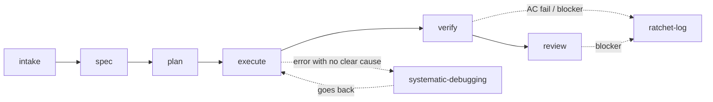

# Getting started with GFT Harness — where to start, when to use it, how to get the most out of it

This file answers 4 practical questions: **what is here** (skills/agents), **what flow it follows**, **what the hooks block or support at runtime**, and **how to get the most out of it in a real project**. For details on each folder's structure, see [README.md](README.md). This file focuses on "how to use it", not "how it is organized".

## 1. One-sentence summary

GFT Harness turns the `intake → spec → plan → execute → verify → review` lifecycle into steps with **a specific agent/skill in charge** and **output that can be checked by a command** (`scripts/validate.sh`), instead of relying on the AI to "remember" the process each time. The runtime hooks hard-block edits to rules/registry outside the review process.

## 2. Overall flow



| Phase | Slash command | Agent | Main skill | Output artifact |
|---|---|---|---|---|
| intake | `/gft:intake` | `business-analyst` | `intake-request` | `intake-brief.yaml` |
| spec | `/gft:spec` | `solution-architect`, `business-analyst` | `feature-roadmap` → `impact-analysis` → `task-spec` → `adr` (when needed) | `task-spec.yaml` |
| plan | `/gft:plan` | `solution-architect` | `plan-review` → `test-plan` → `adr` (when needed) | `plan-review-result.yaml`, `test-plan.yaml` |
| execute | `/gft:execute` | `developer` | — (calls `systematic-debugging` when stuck) | diff + `*-report.md` report |
| verify | `/gft:verify` | `qa-engineer`, `security-reviewer` (when an escalate path is touched) | `verify-change`, `security-review`, `ratchet-log` (if it fails) | `verification-result.yaml` |
| review | `/gft:review` | `code-reviewer`, `security-reviewer` | `review-change`, `ratchet-log` (if blocker), `pr-description` (when approved) | `review-result.yaml`, `pr-description.yaml` |

`using-gft` is not in the table above because it is not tied to one phase. The `SessionStart` hook injects it at the start of every session, so the agent can check `registry/activation-rules.yaml` and pick the right row in the table on its own — you do not need to remember the exact slash command. `/gft:adr` also does not belong to one phase — use it any time there is an architecture decision that is debated or hard to reverse.

## 3. When to use which skill/agent

Quick table — full input/output details are in [agents/README.md](agents/README.md) and [skills/README.md](skills/README.md).

| What you want to do | Use this |
|---|---|
| You have a raw requirement/ticket, business goal is not clear yet | `intake-request` (skill), `business-analyst` (agent) |
| The requirement is big and needs a roadmap before writing a task-spec | `feature-roadmap` |
| Turn a requirement into a scope + acceptance criteria that can be checked by a machine | `task-spec` |
| The change may touch many modules/services | `impact-analysis` |
| There is an architecture decision with several options, and you need to record why one was picked | `adr` |
| Review the implementation plan before writing code | `plan-review` |
| Turn acceptance criteria into test cases (including negative-path cases) | `test-plan` |
| You need to implement something inside an approved scope | `developer` (agent) |
| A bug/failing test has no clear cause, and one fix attempt already failed | `systematic-debugging` |
| You need real evidence (exit code, AC pass/fail) after the code is done | `verify-change`, `qa-engineer` (agent) |
| An independent code review, looking for blockers | `review-change`, `code-reviewer` (agent) |
| A separate security review (authn/authz, secrets, input validation, PII) | `security-review`, `security-reviewer` (agent) |
| There is a failed AC or a blocker verdict — it must not "disappear" | `ratchet-log` (required, not optional) |
| Everything has passed/been approved, and you need a PR description with traceability | `pr-description` |
| Not sure which of the above to use | `using-gft` — already injected automatically, no need to call it by hand |

**Key point that is easy to miss**: `ratchet-log` is not "nice to have". `validate_verify_change`/`validate_review_change` will **hard FAIL** if there is a failed AC or a blocker verdict with no `ratchet_ref`. Do not let the agent "forget" to record a failure.

## 4. The hook system — what it supports at runtime

Hooks only work when the harness is installed **as an enabled plugin** (see section 5). Just opening this folder as a normal project is not enough.

| Hook | Triggers when | What it does | Hard block? |
|---|---|---|---|
| `session-start` | Session starts/clears/compacts | Injects `skills/using-gft/SKILL.md` into context — the agent knows to check the registry before acting | No, it only passes information |
| `check-protected-paths` | `PreToolUse` on `Edit`/`Write` | Blocks edits to `rules/**`, `hooks/**`, `registry/**`, and every `manifest.yaml` (reads from `rules/protected-paths.yaml` at run time, plus the project's own paths from `.gft/project.yaml` if it exists) | **Yes** — exit code 2. For `escalate_paths`, it asks for confirmation (`permissionDecision: ask`) instead of a hard block |
| `check-agent-manifest` | `SubagentStop` | Compares the `tools:` frontmatter against `allowed_tools` in the manifest, counts turns/usage, works out which tool group was really used versus the declared `authority`, and runs `verification.command` itself if it finds a matching report file — writes a JSON log to `.gft/logs/agent-runs.jsonl` | No, it only warns and logs |

In practice this means: you (or an agent given a task to "just edit the rule to make this faster") **cannot** quietly loosen a rule or the registry while running a task. Any change to those paths must go through a PR and CODEOWNERS review, not through a random Edit in a session.

## 5. Using it in a real project — getting the most out of it

### Step 1 — Install the plugin

```bash
make install-plugin                                    # user scope: every project on this machine
make install-plugin SCOPE=project TARGET=/path/to/proj  # only that project
```

See [PLUGIN_INSTALL.md](PLUGIN_INSTALL.md) if you want to install it by hand through `/plugin` in a session, or if you only want the hooks without installing the whole plugin.

### Step 2 — Declare the project's own rules

```bash
make init-project TARGET=/path/to/project
```

This scaffolds `.gft/project.yaml` (pre-filling `stacks` using `scripts/detect_stack.sh`). This file can only **add** protected/escalate paths for the project (`protected_paths_extra`, `escalate_paths_extra`). It cannot loosen a harness rule (there is no `*_override` field). This is the place to declare paths that are specific to the project, for example a DB migration folder, a custom CI/CD config, a secret template, and so on.

### Step 3 — Follow the slash command for the current phase

Do not jump straight into implementation and think about spec/plan later. Fixing a `task-spec.yaml` costs much less than rewriting code that was built with the wrong scope.

```
/gft:intake  <raw requirement>       # if the business goal/stakeholder is not clear yet
/gft:spec    <requirement/ticket>    # produces task-spec.yaml with ACs that have ids, allowed/protected scope
/gft:plan    <task-spec.yaml>        # plan-review approved + test-plan before writing code
/gft:execute <task-spec.yaml>        # developer only edits inside allowed_scope
/gft:verify  <diff + task-spec>      # real evidence, not "I think it works"
/gft:review  <diff + verify>         # independent review + security, then pr-description
```

Each step has its own **exit gate** (written in `commands/*.md`). Do not move to the next step until `scripts/validate.sh <kind> <file>` shows PASS.

### Step 4 — Turn on real CI, do not rely only on the local hook

The local hook (`check-protected-paths`) is only fast feedback inside one session. It can be skipped if a change comes from outside that session (a manual commit, a different agent, a human editing directly). To get real authority:

1. Copy/adjust this harness's `.github/workflows/validate.yml` for the project's own CI (run `make validate` the same way on the project's side, or call `scripts/validate.sh` directly if the project only uses the hooks and not the full harness registry).
2. Turn on the required status check for the main branch in **Settings > Branches**. This step cannot be done through a file — you must turn it on by hand.
3. Check the project's `CODEOWNERS` against the protected paths (`rules/protected-paths.yaml` + its own `protected_paths_extra`) to make sure the right people are required to review.

### Step 5 — Watch the ratchet-log as a quality signal

The project's `.gft/ratchet-log.yaml` collects every AC failure and blocker verdict that has ever happened. Read this file regularly (not just when something fails) to spot repeating patterns. That is a sign you should add a rule stack (`rules/stacks/`) or tighten the `task-spec` template, instead of leaving each failure as just a separate log entry.

### Common mistakes to avoid

- **Skipping spec/plan because "the task is small"**: `using-gft` deliberately does not accept "simple" as a reason to skip the routing step. Checking the registry costs less than redoing work because the scope was wrong.
- **Editing `rules/**`/`registry/**` yourself to "make the task go faster"**: the hook hard-blocks this for good reason. A change at these paths that skips review could quietly turn on the wrong capability for every task after it.
- **Opening the harness as a normal project just to test the hook**: the plugin hooks are only active after `/plugin install` or `claude --plugin-dir .`. Opening this folder directly as a normal project will NOT turn on the hooks (see [hooks/README.md](hooks/README.md)).
- **Treating `verification-result.yaml`/`review-result.yaml` as a formality**: if an AC fails or there is a blocker with no `ratchet_ref`, `scripts/validate.sh` fails right away. There is no way to "pass" without fixing the file.

## 6. Related files

- [README.md](README.md) — directory structure, governance, the verifiability principle.
- [PLUGIN_INSTALL.md](PLUGIN_INSTALL.md) — full install/uninstall steps, how to confirm it loaded correctly.
- [agents/README.md](agents/README.md), [skills/README.md](skills/README.md) — full input/output/verify details for each agent/skill.
- [hooks/README.md](hooks/README.md) — details on each hook, the cross-platform wrapper.
- [registry/README.md](registry/README.md) — how a phase maps to an agent/skill, catalog cross-check.
- [commands/README.md](commands/README.md) — details on each slash command and its exit gate.
